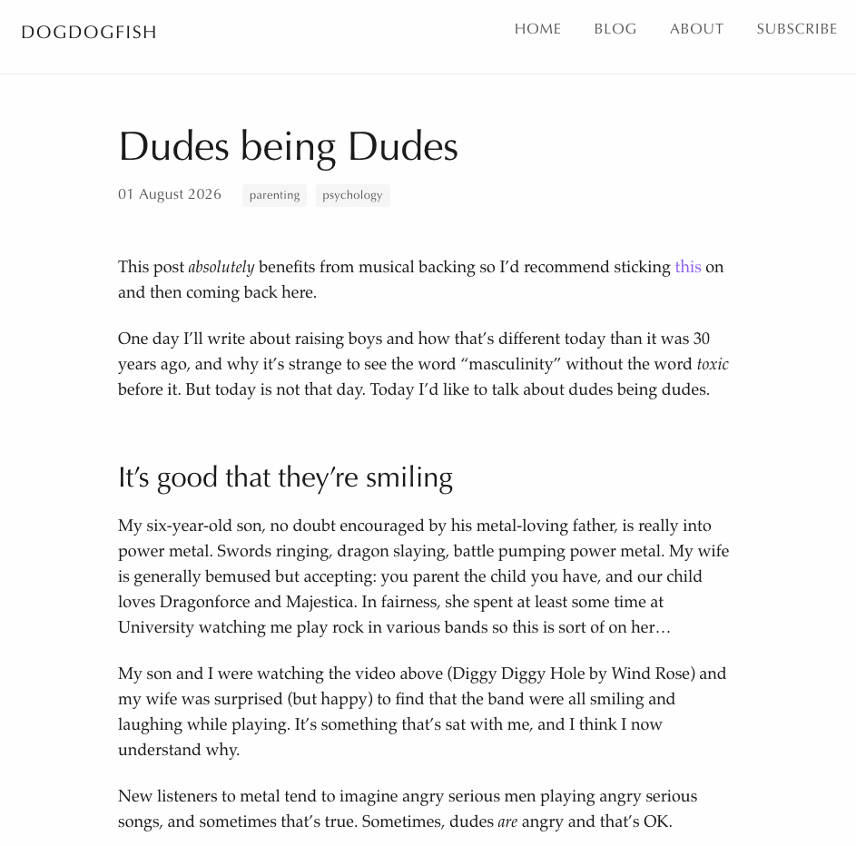
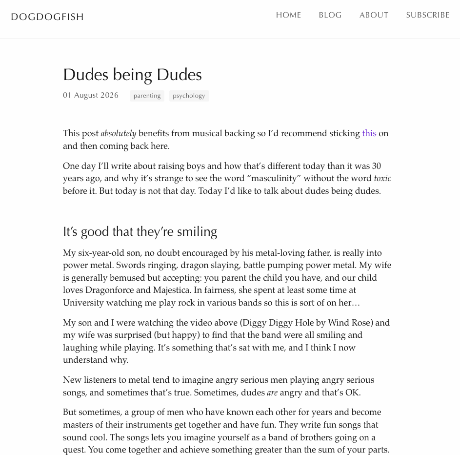

I just finished up reading a book that was _way_ out of my wheelhouse;
[Butterick's Practical Typography](https://practicaltypography.com/) is an
introduction to modern typographical practices. A colleague recommended I read
it, and share what I thought about it.

## Online economics

One of the more interesting elements of the book is the monetisation model it
uses. Butterick argues that unless we pay for writing, we necessarily encourage
other economic models. Advertising. Paywalls. Things that erode the
vitality and quality of the open web. Instead, he makes the book freely
available, but asks that you pay for it if you get value from it, commensurate
with the amount you'd pay for a _real_ book.

I think this is laudable, but ultimately I'm a cynic when it comes to human
behaviour and economic models. The gap between $0 and $1 is like a gulf of a thousand miles, compared to the gap
between $1 and $2. Free is a category all of its own.

If you want to grow to a billion users, you have to offer a free service. That
leaves monetisation via advertising. That leads to the attention economy, and
the enshittification of the internet. There's a fun discrepancy here: how much
advertisers value our attention, versus how much we value our own attention.

Facebook's average revenue per user (ARPU) in the US is something like $250 per year. That
means that on average, advertisers were willing to pay $250 for the attention
that they could extract from a person in the US in a year. Would Facebook's
average user be willing to pay $250 to preserve their attention, such that they
can spend it elsewhere? Clearly, no.

I don't want to blame anybody here in this---I think everybody is making
rational choices. Advertisers only pay for the time if it makes them money.
People only spend their attention if they value it that cheaply. I'll write
something in the future about why I believe people value their time and
attention so cheaply. But anyway...we digress.

## Typography

The introductory chapters were my favourite, because before reading this, I'd
squarely lump myself in with those who don't care about typography. Sure, some
fonts are better than others. To elevate that instinct to a named profession
sounded ridiculous. However, usually whenever I think some profession sounds
ridiculous, it's because I've not understood what they do. Perhaps I should
start giving all professions the same grace?

I do write a lot online, and much of my purpose is to entertain and/or
influence. The written word is my medium, and so of course I should at least
not embarrass myself when it comes to typographic elements. I don't know that
I'd say I was embarrassing myself before, but I'd certainly not consciously
considered elements of page layout, margins, letter and line spacing, and
formatting options.

Some of the elements in the book seemed esoteric to me, and of course Butterick
cares about this more than it would be practical for me to do so, and of course
he recommends professionally designed fonts (like his own) as being a step
above _normal_ fonts (though I can only assume they too, were professionally
designed)...but there were certainly elements that I need to work on.
Fortunately, quotation marks and apostrophes are largely handled without me
even being aware of my mistakes. Em-dashes less so. My capitalisation of
headings is all over the place, and I've used x rather than × on more than one
occasion.

## Website design

One of the key things I liked about the book was its applicability to website
design. I'm not a designer, but I have opinions about what constitutes good
design: opinions that have very little to do with colours and styles.

As with typography, I don't think there are fixed rules when it comes to website
design. Typography is in service of a purpose. A piece of text has a job to do,
and typography is there to help it succeed. A website is there to do a job, and
every element of the website should only exist in service of that job.

The purpose of Booking.com's website is to get you to book a night in a hotel.
Anything on that page that doesn't help somebody do that is wasted. Bytes that
travelled to your computer and didn't need to. Potential sinks of your
attention that distract you from your goal. Without stating the goal of the
website, you don't get to say what's a distraction and what isn't. But once you
know what the goal of the website is, it's clear what the distractions are and
what aren't.

That's why websites that don't define their purpose clearly are doomed to be
complicated messes. Without a purpose, nothing can be called a distraction,
because anything might be the point.

## Automated typography

Despite it being somewhat antithetical to the book (and the nuanced role that
typography can play), I decided to run Claude Code over this blog, and ask it
to generate suggestions for things I should change that would better align me
with the book. There were some suggestions on my writing style, which I will
henceforth try to implement (not using bold and italics for emphasis at the
same time, not using headings with a single paragraph underneath), but more easily fixed were the
mechanical items that can be batch implemented.

Have a look at these two versions of the same post and see if you think there's
an appreciable difference:

<figure class="figure-pair">
  <figure>
    
    <figcaption>Before</figcaption>
  </figure>
  <figure>
    
    <figcaption>After</figcaption>
  </figure>
</figure>

Overall, I'm glad that I read this book. It's not going to go down in the
canon of all-time greats, and I'm not sure it'll fundamentally change how I
approach the world or my work. However, I do think it's nice to consider that
the words I write are much more than just the words themselves. How those words
appear on screens can change how likely they are to be read, and how they're
interpreted. I hope I remember that going forward.
